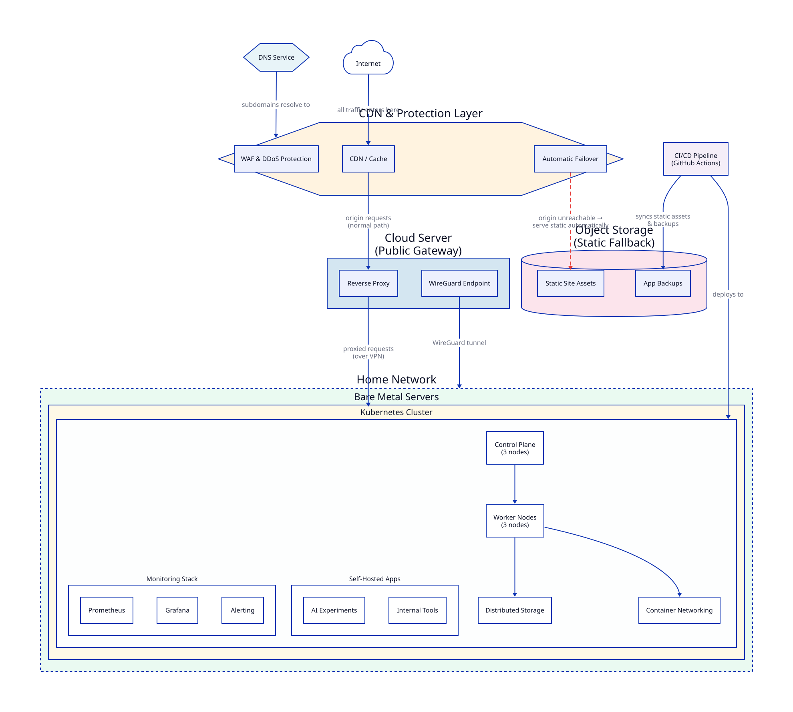

## Why a Homelab

I have been running this thing for years now. Not because I need it for work. Not because it saves me money. Honestly, on pure accounting, it probably costs more than just using managed services.

I run it because it breaks. And every time it breaks, I learn something I could not have learned any other way.

That is the honest answer.

## The Bill That Started It

Before the homelab, I hosted things on cloud. VMs, managed databases, a few small apps. Nothing extravagant. But cloud bills have a way of growing silently. You spin something up to try it, forget to tear it down, and three months later you are staring at a line item you do not recognise. Multiply that across a few services and a few experiments and the number gets uncomfortable fast.

The worst part is not the amount. It is that you do not notice until the bill arrives. By then the thing has been running for weeks.

Now I pay for electricity and internet. Both of which I need anyway — the homelab is just a bonus load on top. The incremental cost of running six servers at home is a fraction of what a comparable cloud setup would cost. And there are no surprise line items. The electricity bill does not suddenly spike because I forgot to stop a VM.

This is not a recommendation to shut down your cloud account. Managed services are genuinely good and for many things the right answer. But for a learning environment where you spin up and tear down constantly, owning the hardware pays for itself faster than you'd think.

## What Actually Runs Here

Let me be upfront. There are no critical applications here. Nothing production. No customer data. No business-critical workloads.

What runs here:

- **DevOps tools** I want to understand before recommending them to others. If I write about K8sGPT or Botkube, it is because I ran it here first.
- **Open source projects** I am evaluating, contributing to, or just curious about.
- **Local LLMs** for practice. Ollama with a few models. I test prompts, agents, tool integrations — all without sending data to external APIs.
- **Monitoring and logging tools.** More on this below. There are a lot of them.
- **A few hobby apps.** Things I built, things I found interesting, things that run quietly in the background.

A handful of friends and fellow engineers also have access. Not as users of any app specifically — more as a shared learning environment. Someone wants to explore Grafana dashboards, or test a Kubernetes deployment, or see how Prometheus scraping works in practice. This homelab is that place.

## The Architecture

Starting from the top.

### CDN and Protection Layer

All public traffic passes through a CDN and protection layer first. This handles caching, WAF, and DDoS protection. It also does something I appreciate: automatic failover. If the cluster goes down, the CDN detects the origin is unreachable and serves a static version of the site directly from object storage. No manual intervention needed. As far as anyone visiting the blog is concerned, nothing happened.

### DNS

A managed DNS service handles all subdomain routing. This is the one layer I treat as genuinely load-bearing. Everything else can be rebuilt. If DNS is wrong, everything looks broken even when it is not.

Most subdomains are private — only reachable over VPN. A very small number of things are public-facing, and even those sit behind the CDN.

### The Public Gateway

One small cloud server. It does two things and nothing else.

A reverse proxy that terminates TLS and routes traffic inward. Nothing inside the home network is directly reachable from the internet. Everything goes through here.

A WireGuard endpoint for my own remote access. When I am not home, I connect through WireGuard and from there I can reach everything — dashboards, the cluster API, internal tools, everything.

The gateway does not run any applications. It is a dumb, hardened router.

### Home Network and Bare Metal

Inside the home network, bare metal servers running a Kubernetes cluster. Three control plane nodes, three workers. Overkill for hobby workloads. That is the point — I want to run the same topology that production environments use, so when something fails I experience what production teams experience.

The cluster uses distributed storage for persistent volumes. This is the layer that causes the most interesting problems. Distributed storage on commodity home hardware is not boring. I have learned a lot from it going wrong at inconvenient times.

### Object Storage

A backup and fallback layer. The CI/CD pipeline syncs static builds and database backups here on every deploy. Two jobs: feed the CDN failover, and be the recovery point if something goes truly wrong.

### CI/CD

GitHub Actions. Push code, pipeline runs, things deploy. I keep this deliberately boring. The homelab itself is complex enough — the deployment pipeline should not be.

## Reliability

The homelab goes down occasionally. Almost always for one reason: the local internet provider. Power is not an issue — there is a backup power supply in place. The cluster itself is fairly stable.

When it does go down, the static fallback kicks in automatically via the CDN. Most people do not notice.

I do not chase five nines here. It is a homelab. The goal is learning, not uptime SLAs.

## Security

This is the part I probably over-engineer relative to what actually runs here. But security tooling is also something I want to understand deeply, so the homelab is where I practice it.

Layers in place:

- **CDN and WAF** — WAF, DDoS protection, and rate limiting before anything reaches my network
- **Router-level firewall** — hardware firewall rules at the network boundary
- **OS-level firewall** — iptables rules on every machine
- **Intrusion prevention** — fail2ban equivalent running on exposed services, banning IPs after repeated failed attempts
- **Hardened OS** — each machine goes through a baseline hardening process. Unnecessary services disabled, SSH configuration locked down, unattended upgrades enabled.
- **WireGuard VPN** — nearly everything internal is only reachable over VPN. No open ports for internal tools.

The attack surface is intentionally small. Almost nothing is publicly reachable. The things that are publicly reachable sit behind the CDN and the reverse proxy, with no direct path into the home network.

I run security scanning tools here too — both to monitor the homelab itself and to learn how they work before writing about them.

## Monitoring and Alerting

There are a lot of monitoring tools here. Probably too many. But again, that is the point.

The monitoring stack covers:

- **Metrics** — Prometheus scraping everything, Grafana dashboards for visualization
- **Logs** — centralized log aggregation, searchable
- **Alerting** — rules for pod failures, node pressure, storage issues, certificate expiry, unusual traffic patterns
- **Notifications** — alerts go to Discord and Telegram. Both, because I am more likely to see one or the other depending on where I am. If something breaks at 2am, I find out at 2am.
- **AI-assisted diagnostics** — tools like K8sGPT and HolmesGPT running here, part of the AI tools series I am writing

The monitoring monitors itself too. If Prometheus goes down, something tells me Prometheus went down. At some point you have to stop, but I have not found that point yet.

## Local LLMs

I run Ollama with a few models locally — on the cluster and on a dedicated machine. The use case is practice. Testing prompts, building agents, trying integrations — all without sending data to external APIs and without running up a bill for every experiment.

This is the foundation for the AI tools series I am writing. Every tool I test in that series runs against this local setup first before I write about it.

## What This Series Covers

This post is the map. Future posts zoom into individual layers:

- **Monitoring deep dive** — what I actually watch, how alerts are structured, what has woken me up
- **Security tooling** — what is installed, how it is configured, what it has caught
- **AI in the homelab** — the full series on K8sGPT, Botkube, HolmesGPT, and more
- **Local LLM setup** — Ollama, models, agent integrations
- **The WireGuard setup** — how remote access works end to end
- **Self-hosted apps** — what runs, why, and what I learned from each
- **The D2 diagram pipeline** — how this architecture diagram is generated automatically from code

Follow the `Homelab` tag to find everything in the series.

---

*drafted with ai assist, because practicing what I preach.*
