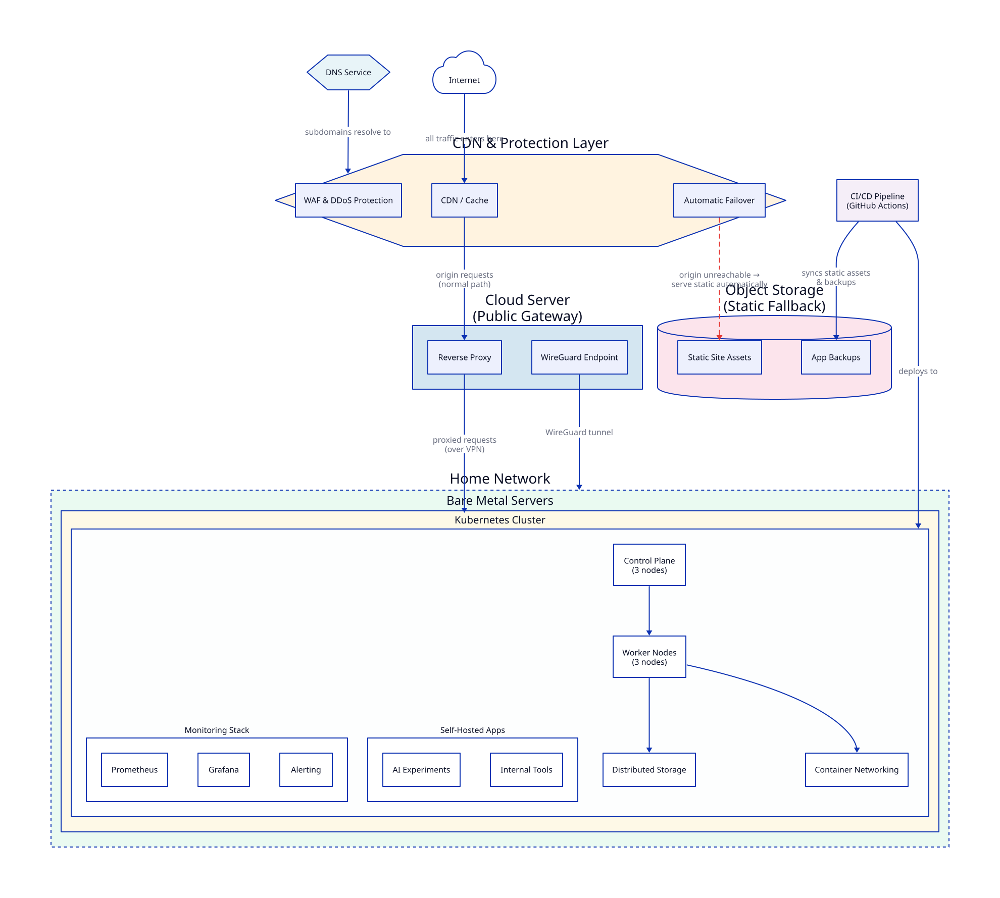

## Why I Am Writing This

I have been running a homelab for a while now. Kubernetes cluster, monitoring stack, a few self-hosted apps, some AI experiments. I keep writing about individual pieces — the Cindy agent, the local LLM setup, the Nagios nostalgia. But I never wrote about the whole thing.

So this is that post. A high-level map of how everything fits together.

A few things I am intentionally leaving vague. I am not going to say which cloud provider hosts my public gateway. I am not going to name the DNS service. I am not going to tell you what the bare metal servers are. Some of this is security hygiene. Some of it is just that the specific vendor does not matter — what matters is the shape of the architecture.

Also, this is the first post in a series. Future posts will zoom into specific layers. The monitoring setup. The AI tooling. The self-hosted apps. This post is the index.

## The High-Level Picture

That is the shape. Simple on paper. A little more interesting underneath.

## Layer 0: CDN and Protection

Before anything reaches my servers, it passes through a CDN and protection layer. This handles three jobs: caching, WAF and DDoS protection, and automatic failover.

The failover part is the one I am most pleased with. If the cluster goes down — power cut, Longhorn having a bad day, a bad deploy at midnight — the CDN automatically detects that the origin is unreachable and starts serving a static version of the site directly from object storage. No manual intervention. No one notices except me.

This means the homelab going down is invisible to anyone visiting the blog or any public-facing static content. The apps that need the cluster to be alive will obviously stop working. But the static presence stays up.

## Layer 1: DNS

Everything starts with a domain name. I use a managed DNS service to handle name servers and subdomain routing. Each subdomain points somewhere — some to the public gateway, some are internal only. The DNS layer is what makes `grafana.roshan.internal` and `app.iamrawtion.com` two entirely different beasts even though they live on the same network.

I keep DNS management separate from everything else. It is the one piece I treat as load-bearing infrastructure. If DNS goes wrong, everything looks broken even when it is not.

## Layer 2: The Public Gateway

One cloud server. Small, cheap, always-on. It does two jobs.

**Reverse proxy.** All public traffic hits this server first. It terminates TLS and routes requests to the right internal service. Nothing inside the home network is directly exposed to the internet. The reverse proxy is the only public face.

**WireGuard endpoint.** This is how I reach the home network when I am not home. My devices connect to this server over WireGuard VPN, and from there they can reach the cluster, the monitoring dashboards, everything. It is a clean split — public traffic through the proxy, my own access through the VPN.

The cloud server does not run any of my actual applications. It is a dumb router with good TLS.

## Layer 3: The Home Network

Behind the VPN sits the real infrastructure. Bare metal servers running inside my home.

I run a Kubernetes cluster. Three control plane nodes, three worker nodes. Not because I need that much for my hobby apps — I run it this way because it is how I stay sharp on production-grade patterns. If I ever get lazy and run a single node, I stop learning how things fail at scale.

The cluster uses a CNI (Container Network Interface) plugin for networking and a distributed storage system for persistent volumes. The storage layer is the part that causes the most interesting problems. Distributed storage on commodity hardware in a home environment is not boring.

GitHub Actions handles CI/CD. When I push code, a pipeline runs. When the pipeline passes, things deploy. I try to keep this boring on purpose.

## Layer 3b: Object Storage (The Safety Net)

Object storage is not glamorous but it earns its place. Two things live there.

**Static site assets.** The CI/CD pipeline syncs a static build of the site to object storage on every deploy. This is what the CDN serves automatically if the cluster is unreachable. It is always slightly behind the live version but always available.

**App backups.** Databases, configs, anything stateful that lives in the cluster gets backed up here on a schedule. If the cluster dies completely — not just a pod going down, but actual data loss — this is where recovery starts.

The CI/CD pipeline writes to both the cluster and object storage on every deploy. Two destinations, one pipeline.

## Layer 4: What Runs on the Cluster

A mix of things. Some are tools I use for the homelab itself. Some are hobby projects. Some are things I am testing before recommending them to others.

**Monitoring stack.** Prometheus, Grafana, alerting. The monitoring monitors the cluster and the apps and, in a few places, things outside the cluster too. I wrote about this separately.

**Self-hosted apps.** A few tools I prefer to run myself rather than pay a subscription for. An email marketing tool. A few internal utilities.

**AI experiments.** This is where the recent Cindy and K8sGPT posts come from. I use the cluster as a playground for AI tooling that interacts with infrastructure.

**This blog.** Ironically, the blog itself does not run on the cluster. It is a static site on GitHub Pages. The cluster is for things that need to actually run.

## What This Series Covers

Each of these layers deserves its own post. Here is what I plan to write:

- **Monitoring setup** — how Prometheus, Grafana, and alerting are configured, and what I actually watch
- **AI in the homelab** — the tools I am testing (K8sGPT, Botkube, HolmesGPT, and more from the series I am running)
- **Self-hosted apps** — what I run, why, and what I learned from each
- **The WireGuard setup** — how remote access actually works
- **CI/CD pipeline** — how GitHub Actions connects to the cluster

I am also building the architecture diagram for this as a D2 file — plain text, version-controlled, generated into SVG by a GitHub Action. That post is coming too, because the tooling choice itself is worth writing about.

## Why Bother?

A few people have asked me why I run all this at home instead of just using managed services.

Partly cost. Running your own Kubernetes cluster is not cheaper in time, but it is cheaper in money once you cross a certain number of services.

Partly skill maintenance. The cluster breaks occasionally. That is a feature, not a bug. Every time something breaks, I learn something. The Longhorn storage volumes going into an unknown state at 11pm on a Tuesday taught me more than any certification.

Partly because I enjoy it. Not everything needs a business justification.

If you are thinking about building something similar, start smaller than you think. A single-node cluster is fine. A Raspberry Pi is fine. The point is to have something you can break and fix without consequences.

I will link each post back to this one as the series grows. If you are reading this in the future, check the tag `Homelab` on the blog — everything from the series will be there.

---

*drafted with ai assist, because practicing what I preach.*
